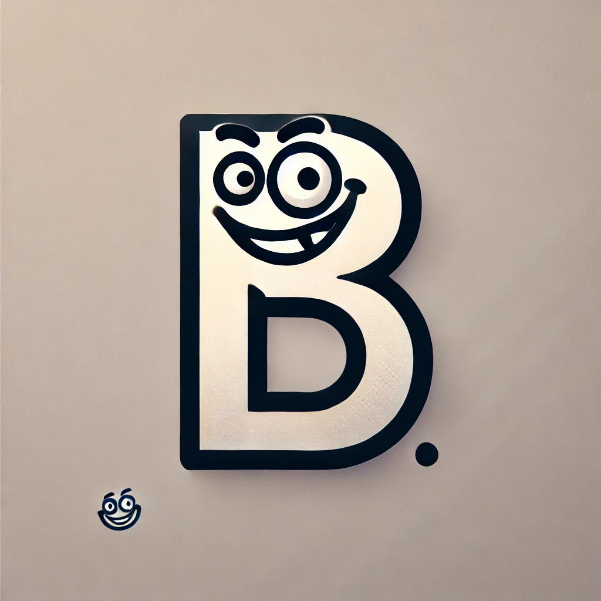

# Minimal Hugo Theme for Modern AsciiDoc-based Blogs

This theme is designed for developers and STEAM audiences who value simplicity, modern standards, and minimal dependencies. It is a humble fork of [antora-default-ui-hugo-theme](https://github.com/basil/antora-default-ui-hugo-theme/) with a focus on building a clean, professional, and blogging-friendly platform.




**Key Principles:**
- Minimalism: Keep dependencies focused and avoid JavaScript frameworks.
- Modern Standards: Uses modern CSS, HTML, and JavaScript features. No support for outdated browsers (e.g., Internet Explorer).
- Tailwind CSS v4 utilities for template-owned layout, with semantic CSS retained for generated AsciiDoc markup and stateful components whose selectors cannot safely be replaced by static utility classes.
- Simplicity: Only adds JavaScript when absolutely necessary, and keeps it minimal.

[](https://github.com/basil/antora-default-ui-hugo-theme/blob/master/LICENSE)


---

Antora Default UI Theme for Hugo is based on the [Antora default UI](https://gitlab.com/antora/antora-ui-default), with full support for [Asciidoctor](https://asciidoctor.org/). **([_Demo_](https://antora-default-ui-hugo-theme.netlify.app/))**


## Features

- **Asciidoc Support:** Write content in Asciidoc, rendered by Hugo and Asciidoctor.
- **Responsive Design:** Mobile-friendly layouts using modern CSS.
- **Beautiful, Professional Typography:** Web fonts and CSS for clean, immersive reading on all devices.
- **Syntax Highlighting:** Prefer [Rouge](https://rouge.jneen.net/), with optional [highlight.js](https://highlightjs.org/) support via simple CSS/JS includes.
- **Minimal Navigation & Pagination:** Accessible, simple navigation and pagination.
- **Internationalization:** Uses Hugo’s standard i18n features, nothing custom.


## Prerequisites

Before starting, ensure you have:
- [Installed Hugo](https://gohugo.io/getting-started/quick-start/#step-1-install-hugo)
- [Created a new site](https://gohugo.io/getting-started/quick-start/#step-2-create-a-new-site)
- [Installed Asciidoctor](https://asciidoctor.org/docs/install-toolchain/)


## Installation

_TODO: Add demo with the modern Hugo module workflow._


## Configuration

Configure Asciidoctor attributes in your site's `config.toml`:

```toml
[markup]
  [markup.asciidocext]
    [markup.asciidocext.attributes]
      "icons" = "font"
      "source-highlighter" = "rouge"
  [markup.highlight]
    codeFences = true
```


Optionally, set a description and keywords for the home page:

```toml
[params]
  description = "Lorem ipsum dolor sit amet, consectetur adipiscing elit."
  keywords = ["foo", "bar"]
```


Optionally, set a copyright message and year for the footer:

```toml
copyright = "<name>. All rights reserved."

[params]
  since = <year>
```


Optionally, set a URL for the **Edit this page** feature:

```toml
[params]
  editThisPage = "https://github.com/organization/repository/edit/main/content/"
```


### Customization

You can add custom CSS files by specifying their paths (relative to `assets/`) in your site configuration:

```toml
[params]
custom_css = ["carrousel.css", "profile.css"]
```


### Syntax Highlighting

This theme uses [Rouge](https://rouge.jneen.net/) by default, or [highlight.js](https://highlightjs.org/) for syntax highlighting. The included highlight.js supports common languages and AsciiDoc. To add more languages, [download a custom package](https://highlightjs.org/download/) and place it in `assets/js/vendor/highlight.pack.js`.


## Theme Structure

- `assets/` — CSS, fonts, and JavaScript (plain, modern, minimal)
- `layouts/` — Hugo templates for pages, partials, and base layouts
- `static/` — Static files (images, fonts) served as-is
- `archetypes/` — Default content templates (Asciidoc)
- `i18n/` — Language files for Hugo’s i18n support

## Contribution Guidelines

- Stick to the project philosophy: minimal, modern, and simple
- Do not introduce frameworks, preprocessors, or unnecessary dependencies
- Use plain CSS, HTML, and JavaScript. Only add JS if required for usability
- Organize code according to the theme structure above
- Test changes locally using Hugo’s built-in server
- Reference previous Copilot PRs for context on implemented features

## Development & Testing

- Install Hugo, Asciidoctor, Node.js, and npm.
- Run `npm install` once to install the Tailwind CSS v4 CLI.
- Run `npm run css:build` to generate the utilities stylesheet, then `hugo server --source=exampleSite --themesDir=../..` (or `make start`) to preview the theme. `make start` builds Tailwind before starting Hugo. The generated stylesheet is committed, so sites consuming the theme do not need Node.js to build their Hugo site.
- Run `npm run css:watch` alongside Hugo while editing theme templates.
- Keep i18n simple: use Hugo’s language files.
- Submit pull requests with clear descriptions and reference relevant issues or previous PRs.

## Out of Scope

- No support for old browsers (e.g., IE)
- No JavaScript frameworks
- No custom i18n or accessibility frameworks beyond Hugo’s basics

---

## License

Released under the [Mozilla Public License, Version 2.0](https://github.com/olivecdev/hugo-madb/blob/main/LICENSE) (MPL-2.0).


## Acknowledgements

- [Dan Allen](https://github.com/mojavelinux), [Asciidoctor](https://asciidoctor.org/) Project Lead & [Antora](https://antora.org/) Project Co-Lead
- [Basil Crow](https://github.com/basil), [Antora Default UI Theme for Hugo](https://github.com/basil/antora-default-ui-hugo-theme) Project author, lead and owner.
